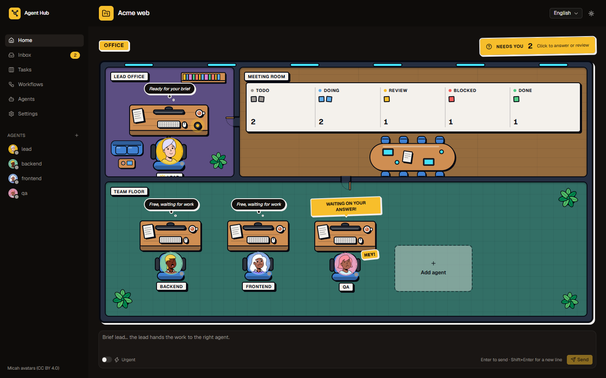

# agent-hub

[](https://www.npmjs.com/package/@minhbc/agent-hub)
[](LICENSE)
[](https://nodejs.org)

**English** | [Tiếng Việt](README.vi.md) · [Website](https://minhbc97.github.io/agent-hub/)



A self-hosted hub that runs the agent CLIs you already have (Claude Code, Codex, Antigravity, or any command) as one
team, with a local web UI. You give the lead agent a goal; it hands parts of the work to other agents, and you review
the results or answer when an agent asks you something.

Each message runs the CLI for one headless turn and resumes the session by id. Agents talk to each other by writing
JSON files into their own outbox folder. Plain output goes to you only, so two agents can't reply to each other
forever. Data is a SQLite file on your machine, the server listens on `127.0.0.1` only, and the hub never reads your
CLI sign-ins. For Claude, MCP servers selected for an agent are copied to a private config file for that turn only;
adding an MCP server runs the CLI's `mcp add` command with the values you entered, and the hub keeps no copy. If you
configure an OpenRouter agent, its prompts are sent to the OpenRouter API.

## Quick start

Requires Node.js 24+ and at least one agent CLI installed and signed in:
[Claude Code](https://docs.claude.com/en/docs/claude-code), [Codex](https://github.com/openai/codex) or
[Antigravity](https://antigravity.google/docs/cli/install). An OpenRouter API key also works, for text-only agents.

```bash
npx @minhbc/agent-hub
```

The hub checks npm for newer versions in the background and shows an update command when one is available.

Open <http://127.0.0.1:4310>. Create a workspace (name, repo path, optional worktree folder), then create the lead
agent when prompted. Click **Test run** on an agent to check that it answers in the **Inbox**.

Data is stored in `./data` under the folder you run the command from. To always use the same place:

```bash
npx @minhbc/agent-hub --data "$HOME/.agent-hub"
```

Use `npx @minhbc/agent-hub@latest` to pick up a new version.

## Features

Engines and sessions:

- Adapters for Claude Code, Codex and Antigravity (new turn, resume, per-turn token usage), OpenRouter over its API,
  and a custom command that reads the prompt on stdin.
- Quota-aware queue: the hub reads each CLI's usage limits, holds work when an engine is out of quota, and can switch
  an agent to a fallback engine until the reset.
- Before a session gets too long or its cache expires, the agent writes a handoff note and the next session starts
  from that note instead of the full history.
- Lean mode for Claude agents cuts the per-call baseline from about 49k tokens to about 10k.
- MCP servers are picked per agent for Claude and Codex; add a server from the hub, which passes its values to the
  CLI's `mcp add` command.

Coordination:

- Each agent works in its own git worktree (default), the shared repo, or a custom folder. With worktrees, a task's code
  moves with it from step to step, and you review the diff before merging it yourself.
- Star routing sends everything through the lead agent; mesh lets chosen pairs talk directly.
- The loop guard stops a chain of agent-to-agent messages after `maxHops` with no human in between.
- Queue limits on concurrent agents and turns per hour, and a per-turn timeout that kills the whole process tree.

In the UI:

- Task board and list (TODO / DOING / REVIEW / BLOCKED / DONE) with review, return and reply actions.
- Workflows with steps for agents or people, review steps, "return to step" on rejection, manual or cron runs.
- A Slack-style inbox with a "Needs you" queue, a home view of the agents at their desks, a map of who talks to whom,
  and run history with tokens and cost.
- In-app guides: coachmarks, a getting-started list, and setup tips for each agent.
- System notifications for important changes while the hub tab is out of view.
- An update notice when a newer version is available on npm.
- English and Vietnamese, light and dark themes.

## Configuration

| Option | Default | Purpose |
| --- | --- | --- |
| `--data <dir>` or `HUB_DATA` | `./data` | Data folder (SQLite DB, agent outboxes) |
| `HUB_PORT` | `4310` | HTTP port |
| `AGENT_HUB_NO_UPDATE_CHECK=1` | unset | Disable the automatic npm version check. The hub checks in the background; configured OpenRouter agents also call the OpenRouter API. |
| `OPENROUTER_API_KEY` | none | Needed only for OpenRouter agents. Never stored in the DB or passed to CLI processes |
| `<data>/models.json` | built-in list | Replaces an engine's model list in the picker, e.g. `{"claude":[{"id":"claude-opus-5-5","label":"Opus 5.5"}]}` |

## Safety

The hub runs commands on your machine, so:

- The server listens on `127.0.0.1` only, rejects cross-origin writes and blocks DNS rebinding.
- Claude agents run with `--permission-mode acceptEdits` (commands such as `npm test` run only if
  listed in the agent's **Allowed commands**, empty by default). `git push/merge/rebase` is blocked unless that exact
  command is listed in **Allowed commands**.
- Codex agents run with `sandbox_mode="workspace-write"` (plus `windows.sandbox="unelevated"` on Windows). Flags are
  passed per turn; `~/.codex/config.toml` is never modified.
- Antigravity agents run with `--mode accept-edits`.

The automatic external connection is the background npm version check, disabled with `AGENT_HUB_NO_UPDATE_CHECK=1`.
OpenRouter agents make API requests when configured.

## Platform support

Tested on Windows 11. macOS and Linux should work but are not tested yet; reports are welcome. The folder picker on
Linux needs `zenity` or `kdialog`.

## Documentation

- [User guide](docs/user-guide.md): workspaces, agents, inbox, tasks, workflows, troubleshooting
- [Architecture](docs/architecture.md): message lifecycle, outbox protocol, loop guard, handoff notes, data
- [REST and SSE API](docs/api.md)
- [Engines](docs/engines.md): adapters, fallback engine, how to add a new one

The docs are in Vietnamese for now.

## Roadmap

- Work hours: when agents start, stop and stop taking new work
- Notifications: browser system notifications are available; Slack and Telegram integrations remain planned.
- Config export / import
- Usage percentage for Antigravity (its CLI only reports when the quota is already used up)

## Contributing

See [CONTRIBUTING.md](CONTRIBUTING.md). Changes are listed in [CHANGELOG.md](CHANGELOG.md).

## License

[MIT](LICENSE). Avatars use [DiceBear Micah](https://www.dicebear.com/styles/micah/) (CC BY 4.0).
