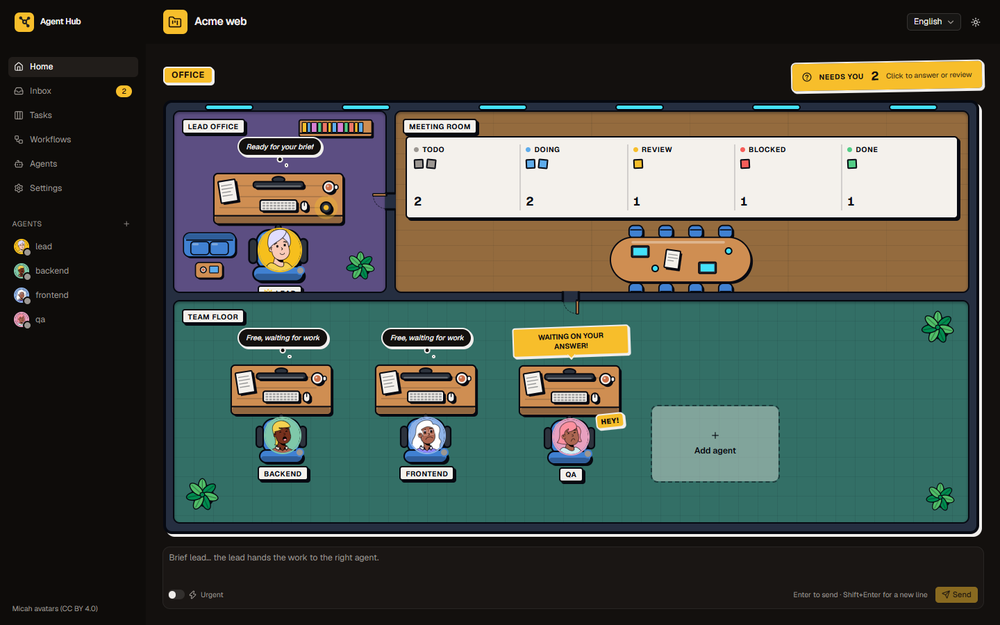

# agent-hub

[English](README.md) | **Tiếng Việt** · [Website](https://minhbc97.github.io/agent-hub/)



Hub tự host để chạy các agent CLI bạn đã có (Claude Code, Codex, Antigravity hoặc lệnh bất kỳ) như một team, có giao
diện web chạy local. Bạn giao mục tiêu cho Lead Agent; nó chia việc cho các agent khác, còn bạn duyệt kết quả hoặc
trả lời khi agent hỏi.

Mỗi tin nhắn chạy CLI một lượt ở chế độ headless và nối session bằng id. Agent nhắn cho nhau bằng cách ghi file JSON vào
thư mục outbox riêng. Câu trả lời thường chỉ bạn thấy, nên hai agent không thể trả lời qua lại vô tận. Dữ liệu là một
file SQLite trên máy bạn, server chỉ nghe `127.0.0.1`, và hub không đọc đăng nhập của CLI. Ngoại lệ duy nhất:
server MCP bạn chọn cho agent chế độ gọn được chép cấu hình, gồm cả token, vào một file riêng chỉ tồn tại trong lượt chạy.

## Bắt đầu nhanh

Cần Node.js 24 trở lên và ít nhất một agent CLI đã cài và đăng nhập:
[Claude Code](https://docs.claude.com/en/docs/claude-code), [Codex](https://github.com/openai/codex) hoặc
[Antigravity](https://antigravity.google/docs/cli/install). Có API key OpenRouter cũng dùng được, cho agent chỉ trả lời
text.

```bash
npx @minhbc/agent-hub
```

Mở <http://127.0.0.1:4310>. Tạo workspace (tên, đường dẫn repo, thư mục worktree nếu muốn), rồi tạo Lead Agent khi
popup hiện ra. Bấm **Chạy thử** trên agent để kiểm tra nó trả lời trong **Hộp thư**.

Dữ liệu nằm ở `./data` trong thư mục bạn chạy lệnh. Muốn luôn dùng một chỗ cố định:

```bash
npx @minhbc/agent-hub --data "$HOME/.agent-hub"
```

Dùng `npx @minhbc/agent-hub@latest` để lấy bản mới.

## Tính năng

Engine và session:

- Adapter cho Claude Code, Codex và Antigravity (lượt mới, resume, token từng lượt), OpenRouter qua API, và lệnh tùy
  chỉnh nhận prompt qua stdin.
- Hàng đợi biết hạn mức: hub đọc hạn mức của từng CLI, giữ việc khi engine hết quota, và có thể chuyển agent sang
  engine dự phòng tới lúc reset.
- Trước khi session quá dài hoặc cache hết hạn, agent viết sổ bàn giao; session sau bắt đầu từ sổ đó thay vì đọc lại
  toàn bộ lịch sử.
- Chế độ gọn cho agent Claude giảm phần nền mỗi lần gọi từ khoảng 49k token xuống khoảng 10k, MCP chọn riêng theo
  agent.

Điều phối:

- Mỗi agent làm trong git worktree riêng (mặc định), repo dùng chung, hoặc thư mục tự chọn.
- Routing star cho mọi tin đi qua Lead Agent; mesh cho các cặp được chọn nhắn thẳng.
- Loop guard dừng chuỗi tin agent→agent sau `maxHops` tin không có người chen vào.
- Giới hạn số agent chạy cùng lúc và số lượt mỗi giờ, timeout mỗi lượt kill cả cây tiến trình.

Giao diện:

- Board và list công việc (TODO / DOING / REVIEW / BLOCKED / DONE) với duyệt, trả lại, trả lời.
- Quy trình gồm các bước cho agent hoặc người, bước cần duyệt, quay lại bước trước khi bị trả, chạy tay hoặc cron.
- Hộp thư kiểu Slack với hàng "Cần bạn", trang chủ vẽ các agent ngồi ở bàn, sơ đồ ai nhắn cho ai, lịch sử lượt chạy
  kèm token và chi phí.
- Tiếng Việt và tiếng Anh, giao diện sáng và tối.

## Cấu hình

| Tùy chọn | Mặc định | Việc |
| --- | --- | --- |
| `--data <thư mục>` hoặc `HUB_DATA` | `./data` | Thư mục dữ liệu (DB SQLite, outbox của agent) |
| `HUB_PORT` | `4310` | Cổng HTTP |
| `OPENROUTER_API_KEY` | không có | Chỉ cần cho agent OpenRouter. Không lưu vào DB, không truyền cho tiến trình CLI |
| `<data>/models.json` | danh sách có sẵn | Thay danh sách model của engine trong ô chọn, vd. `{"claude":[{"id":"claude-opus-5-5","label":"Opus 5.5"}]}` |

## An toàn

Hub chạy lệnh trên máy bạn, nên:

- Server chỉ nghe `127.0.0.1`, chặn request ghi khác origin và chặn DNS rebinding.
- Agent Claude chạy với `--permission-mode acceptEdits` (lệnh như `npm test` cần thêm `--allowedTools` vào **Tham số
  thêm**) và bị chặn `git push/merge/rebase` qua `--disallowedTools`.
- Agent Codex chạy `sandbox_mode="workspace-write"` (thêm `windows.sandbox="unelevated"` trên Windows). Cờ chỉ truyền
  cho từng lượt, không sửa `~/.codex/config.toml`.
- Agent Antigravity chạy với `--mode accept-edits`.

Hạn chế đã biết: chặn `git push` theo tiền tố lệnh, chưa bắt được dạng `git -C dir push`.

## Nền tảng

Đã chạy trên Windows 11. macOS và Linux chưa thử, rất mong được báo lỗi. Hộp chọn thư mục trên Linux cần `zenity` hoặc
`kdialog`.

## Tài liệu

- [Hướng dẫn sử dụng](docs/user-guide.md): workspace, agent, hộp thư, task, workflow, xử lý sự cố
- [Kiến trúc](docs/architecture.md): vòng đời tin nhắn, giao thức outbox, loop guard, sổ bàn giao, dữ liệu
- [API REST và SSE](docs/api.md)
- [Engine](docs/engines.md): các adapter, engine dự phòng, cách thêm engine mới

## Lộ trình

- Giờ làm việc: giờ agent bắt đầu, dừng, ngừng nhận việc mới
- Thông báo (Windows toast, Slack, Telegram)
- Xuất / nhập cấu hình
- % hạn mức đã dùng cho Antigravity (CLI chỉ báo khi đã hết quota)

## Đóng góp

Xem [CONTRIBUTING.md](CONTRIBUTING.md). Lịch sử thay đổi ở [CHANGELOG.md](CHANGELOG.md).

## Giấy phép

[MIT](LICENSE). Avatar dùng [DiceBear Micah](https://www.dicebear.com/styles/micah/) (CC BY 4.0).
